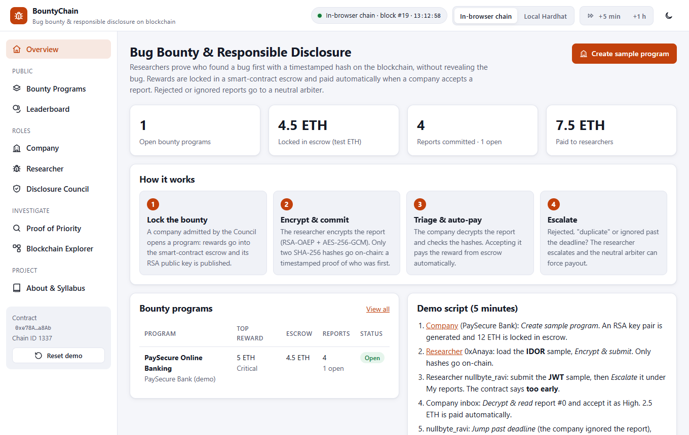
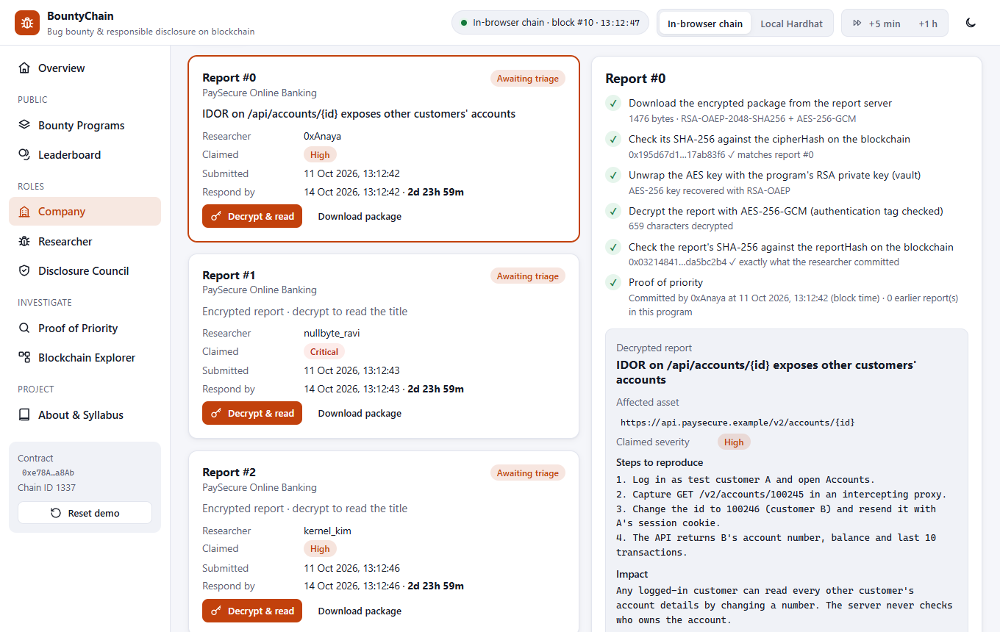
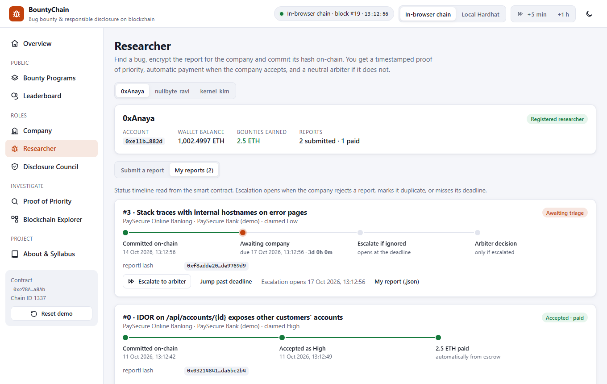
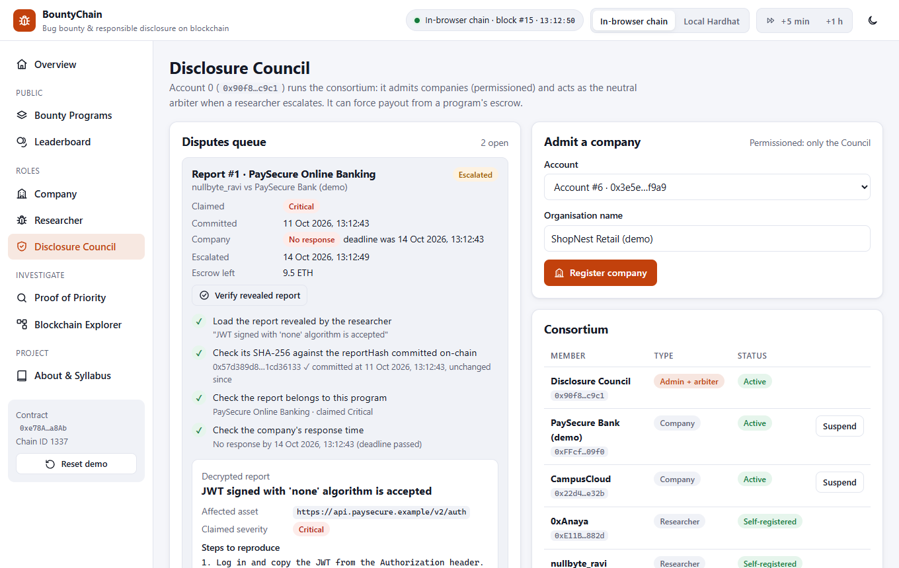
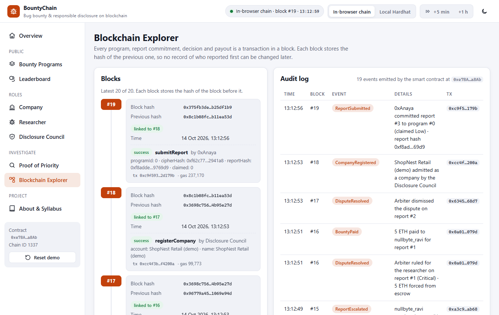
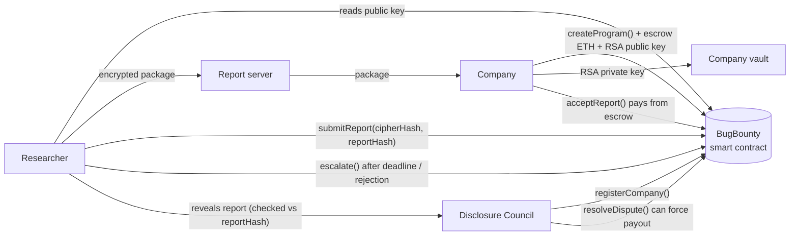

# BountyChain: Bug Bounty & Responsible Disclosure Platform

A blockchain platform where companies **lock bug bounty rewards in a smart-contract escrow**, researchers **prove who found a bug first** with a timestamped on-chain hash (without revealing the bug), and a **neutral arbiter** can force payout when a report is rejected or ignored.

**Live demo:** https://syedareeb06.github.io/bug-bounty-disclosure-platform/ (runs entirely in your browser: no wallet, no install, test ETH only)



---

## The problem

Security researchers who responsibly report vulnerabilities take a risk:

- they may never be credited or paid, because the reward is only a promise,
- a company can silently ignore a report, or reject it with "we already knew", and
- there is no neutral record of who found a bug first.

## The solution

| Step | What happens | Technique |
|---|---|---|
| 1. Lock the bounty | A company admitted by the Disclosure Council opens a program. The rewards (Low / Medium / High / Critical) are **deposited into the smart contract** together with the company's RSA public key. | `payable` escrow, RSA-OAEP 2048 |
| 2. Encrypt & commit | The researcher encrypts the report in the browser for that company. The ciphertext stays off-chain; **only two SHA-256 hashes** go on-chain. The block time is the proof of priority. | AES-256-GCM + RSA-OAEP (hybrid), salted SHA-256 commitment |
| 3. Triage & auto-pay | The company decrypts the report and checks both hashes against the chain. **Accepting pays the reward from escrow automatically.** "Duplicate" must point to an earlier on-chain report. | Smart contract, checks-effects-interactions |
| 4. Escalate | If the company rejects the report, marks it duplicate, or **misses the response deadline**, the researcher escalates. The Council verifies the revealed report against its hash and can **force payout** from escrow. | Time-based rules, neutral arbiter |

## Features

- **Company**: generate an RSA key pair, lock escrow, decrypt reports with a 6-step integrity checklist, accept (auto-pay) / reject / mark duplicate, top up, close and withdraw, back up or restore the private key (.pem)
- **Researcher**: self-register a handle (permissionless), submit encrypted reports with live steps, status timeline per report, escalate (blocked by the contract until the deadline), jump past the deadline for the demo
- **Disclosure Council**: admit or suspend companies, disputes queue, verify the revealed report against the on-chain hash, rule and force payout
- **Proof of Priority**: paste any report or encrypted package and see who committed it and when; one changed character and there is no match
- **Leaderboard**: hall of fame by earnings and a public company track record (ignored reports, disputes lost)
- **Blockchain Explorer**: hash-linked blocks, decoded transactions and an audit log in plain sentences
- Built-in sample programs and vulnerability reports (fictional `.example` targets), ETH balances shown so payouts are visible
- Two blockchains: an **in-browser Ethereum chain** (zero setup) or a **local Hardhat node**

| Company decrypts and triages a report | Researcher's report timelines |
|---|---|
|  |  |

| Disclosure Council resolves a dispute | Blockchain explorer |
|---|---|
|  |  |

## Syllabus mapping (22CS743, Blockchain Technology)

| Module | Concepts | Where they appear in this project |
|---|---|---|
| **II** | Hash functions, hash commitments, timestamping as proof of priority, hash-linked blocks | Salted SHA-256 `reportHash` and `cipherHash` committed with the block time; `findReport()` lookup on the Proof of Priority page; the explorer checks every block's previous-hash link |
| **III** | Ethereum, EVM, smart contracts, symmetric & asymmetric cryptography | `BugBounty.sol` escrow (`payable` deposit, ETH transfer on accept or ruling); RSA-OAEP 2048 wraps a random AES-256-GCM key (hybrid encryption); every transaction is signed by an account key |
| **IV** | Consortium / permissioned blockchain, governance | Companies are admitted or suspended by the Disclosure Council; researchers join without permission; the Council is the neutral arbiter |
| **V** | Cybersecurity application, smart-contract security, privacy | Responsible disclosure workflow; checks-effects-interactions, re-entrancy lock, role checks and custom errors (tested with an attack contract); only hashes on-chain |

## Architecture



**On-chain:** companies, researcher handles, programs (scope, rewards, escrow, RSA public key, response window), report hashes, claimed and awarded severity, timestamps, decisions, payouts and disputes.
**Off-chain:** the encrypted report packages (report server), each program's RSA private key (company vault), researchers' own plaintext copies, and reports revealed to the arbiter. Everything on a blockchain is public, so vulnerability details never go on-chain.

## Tech stack

- **Smart contract:** Solidity 0.8.24, Hardhat (local blockchain, 24 tests, deployment)
- **Frontend:** HTML, CSS, JavaScript (no build step), ethers.js v6, Web Crypto API (RSA-OAEP, AES-GCM, SHA-256)
- **Demo blockchain:** Ganache running inside the browser (same EVM, same contract)
- **Hosting:** GitHub Pages

## Project structure

```
bug-bounty-disclosure-platform/
├── blockchain/                       # Smart contract project (Hardhat)
│   ├── contracts/BugBounty.sol
│   ├── contracts/test/ReentrantCompany.sol   # attack contract used only by the tests
│   ├── test/BugBounty.test.js        # 24 unit tests
│   ├── scripts/deploy.js             # deploy + register demo consortium on localhost
│   ├── scripts/export-artifact.js    # copy ABI + bytecode into the web app
│   └── hardhat.config.js
├── frontend/                         # Web app (open index.html)
│   ├── index.html
│   ├── css/
│   ├── js/app.js                     # BountyChain screens and logic
│   ├── js/bounty-crypto.js           # RSA-OAEP keys, hybrid encryption, canonical report JSON
│   ├── js/chain.js                   # in-browser chain / local Hardhat connection
│   ├── js/contract-artifact.js       # compiled contract (generated)
│   └── vendor/                       # ethers.js, Ganache (browser builds)
├── docs/screenshots/
└── index.html                        # redirects GitHub Pages to frontend/
```

## How to run

### Option 1: Zero install (recommended for demos)

Open the [live demo](https://syedareeb06.github.io/bug-bounty-disclosure-platform/), **or** double-click `frontend/index.html`.
An Ethereum blockchain starts inside the page with 10 test accounts (1000 test ETH each). Your data is saved in the browser; click **Reset demo** in the sidebar to start over.

### Option 2: Local Hardhat blockchain

Requires [Node.js](https://nodejs.org/) 18 or newer.

```bash
cd blockchain
npm install
npm run node
```

Keep that terminal open. In a second terminal:

```bash
cd blockchain
npm run deploy
```

Then open `frontend/index.html` and click **Local Hardhat** in the top bar. (If you skip `npm run deploy`, the app deploys the contract itself.)

### Run the smart contract tests

```bash
cd blockchain
npm test
```

### After changing the contract

```bash
cd blockchain
npm run export
```

This recompiles and copies the new ABI and bytecode into `frontend/js/contract-artifact.js`.

## Demo accounts

| Account | Role | Name |
|---|---|---|
| 0 | Platform admin + arbiter | Disclosure Council |
| 1, 2 | Companies (admitted by the Council) | PaySecure Bank (demo), CampusCloud |
| 3, 4 | Researchers (self-registered) | 0xAnaya, nullbyte_ravi |
| 5 | Researcher, registers during the demo | kernel_kim |
| 6 | Company, admitted during the demo | ShopNest Retail (demo) |

All names are fictional.

## 5-minute demo script

1. **Overview** → *Create sample program* → *Generate key & lock escrow*. Watch the 4 steps: RSA key generation, reward table, the escrow transaction (12 ETH), the private key going into the company vault.
2. **Researcher** (0xAnaya) → load the **IDOR** sample → *Encrypt & submit*. Six steps run; only two hashes and the time go on-chain.
3. **Researcher** (nullbyte_ravi) → submit the **JWT 'none'** sample → *My reports* → *Escalate to arbiter*. The smart contract blocks it: **"too early"**, the company still has 3 days.
4. **Company** → *Inbox* → *Decrypt & read* report #0. Six checks pass (cipherHash, RSA unwrap, AES-GCM, reportHash). *Accept & pay* as High: **2.5 ETH is paid automatically** (see the wallet balances).
5. **Researcher** (nullbyte_ravi) → *Jump past deadline* (the company ignored the report) → *Escalate to arbiter*.
6. **Disclosure Council** → *Verify revealed report* → *Rule for researcher & pay*: **5 ETH is forced from escrow**.
7. **Leaderboard**, **Proof of Priority** (*Load* → *Check on blockchain*, then *Change one character*), **Blockchain Explorer**.

Optional: register `kernel_kim` (account 5), submit the same IDOR, mark it **duplicate of #0** as the company and let the Council compare the timestamps.

## Publishing on GitHub Pages

1. Push this folder to a GitHub repository named `bug-bounty-disclosure-platform`.
2. On GitHub: **Settings → Pages → Build and deployment → Source: Deploy from a branch → Branch: `main`, folder: `/ (root)` → Save**.
3. After about a minute the site is live at `https://syedareeb06.github.io/bug-bounty-disclosure-platform/`.

## Limitations and future work

- Rejection reasons and severities are public on-chain. Companies should keep reasons short and generic.
- In a dispute the researcher reveals the plaintext report to the Council (commit-reveal). A production system would encrypt it to the Council's own key.
- The arbiter is a single trusted account. A real platform could use a multi-signature council or a vote among members.
- Only identical reports are detected automatically (same hash). The same bug described in other words needs human triage (duplicate + arbiter).
- If the escrow is too small for a forced payout, the arbiter must wait for a top-up; the company cannot withdraw meanwhile.
- The demo keeps private keys and packages in browser storage. Real companies would use a hardware key store and a real report server, and a production deployment would run on a permissioned network such as Hyperledger Besu.

## License

MIT, see [LICENSE](LICENSE).
